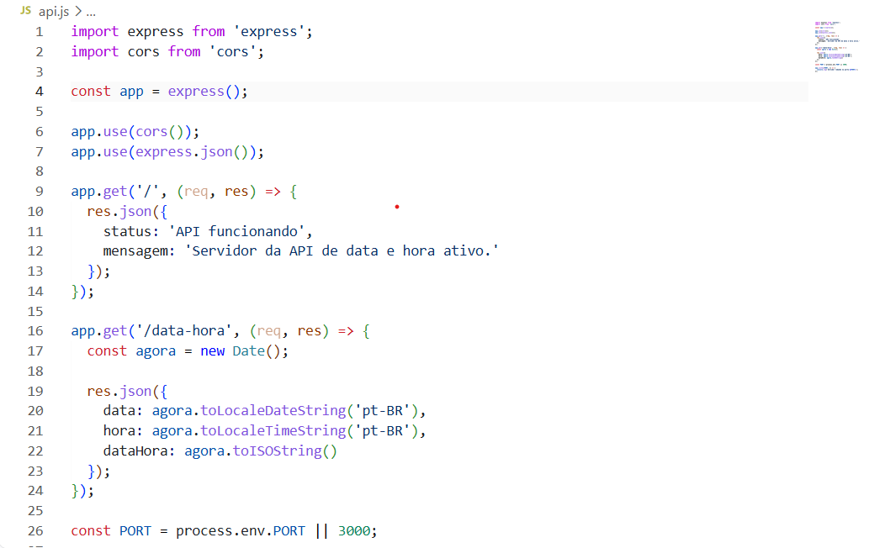
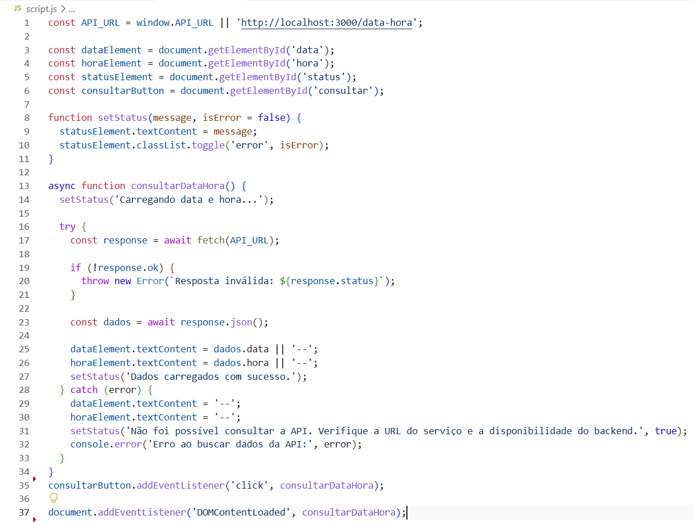
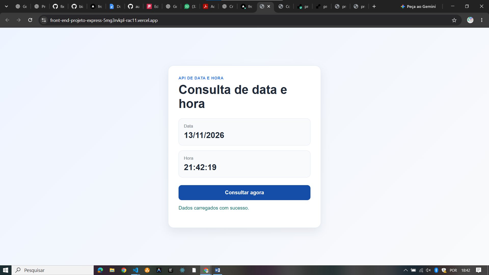
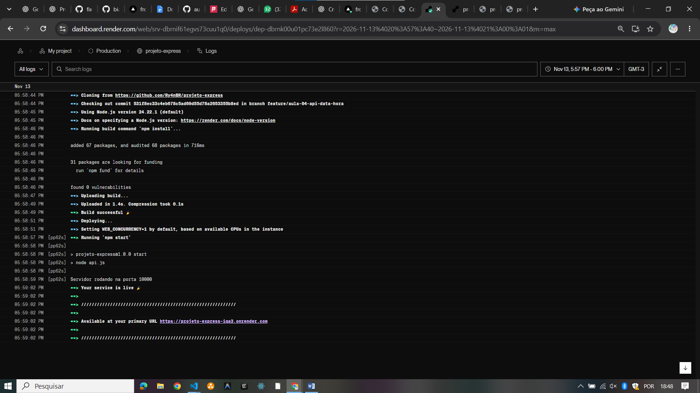
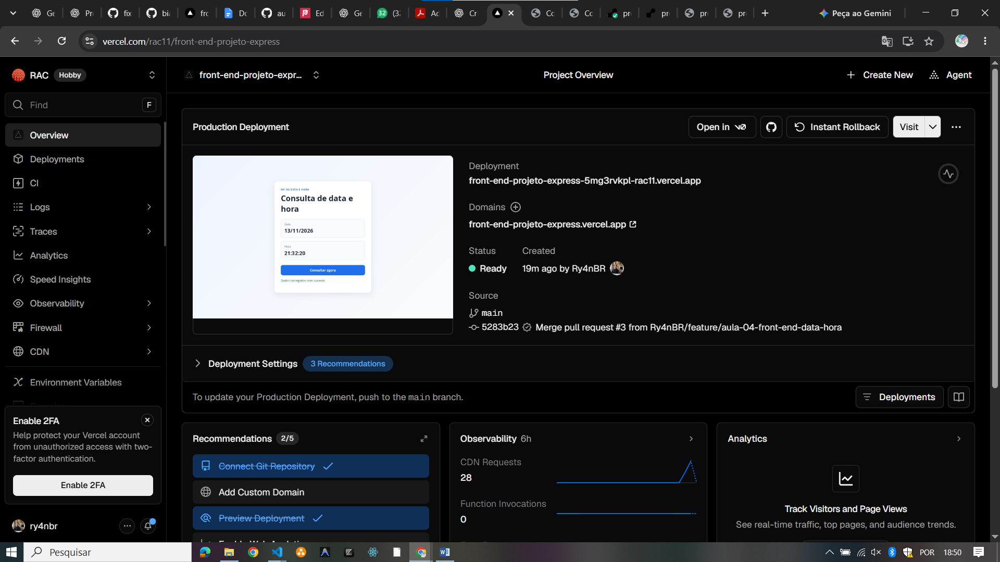

# Entrega da Aula 04

## Objetivo

Implementar uma API em Node.js com Express para consultar a data e hora do servidor, desenvolver um Front-end separado para consumir essa API e preparar a publicação nos serviços Render e Vercel.

## API

A API foi desenvolvida com Express e CORS para permitir acesso de outros domínios. O endpoint principal é:

- `GET /` — mensagem de status da API
- `GET /data-hora` — retorna JSON com `data`, `hora` e `dataHora`

## Tecnologias utilizadas

- Node.js
- Express
- CORS
- HTML
- CSS
- JavaScript

## Repositórios

- API: https://github.com/Ry4nBR/projeto-express
- Front-end: https://github.com/Ry4nBR/front-end-projeto-express

## URLs públicas

- Render (API): https://projeto-express-iqa3.onrender.com/
- Vercel (Front-end): https://front-end-projeto-express-5mg3rvkpl-rac11.vercel.app/


## Evidências

### 1) Código da API





### 2) Resposta do endpoint `/data-hora`

```json
{
  "data": "13/11/2026",
  "hora": "21:55:51",
  "dataHora": "2026-11-13T21:55:51.667Z"
}
```

### 3) Código do consumo no Front-end



### 4) Aplicação funcionando




### 5) Painel do Render




### 6) Painel da Vercel

